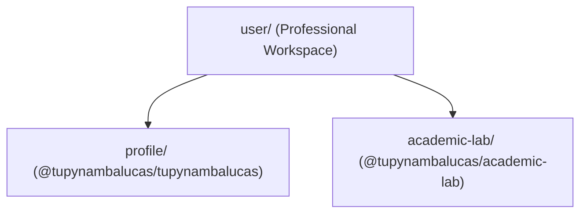

# User Professional Workspace (`tupynambalucas-dev/org/user`)

Subsystem workspace orchestrating individual professional presence, personal GitHub profile configuration, and academic research repositories for developer Tupynamba Lucas (`@tupynambalucas`).

---

## 1. Architecture Overview

The `user/` namespace provides a sovereign developer environment decoupled from the corporate governance of `tupynambalucas-dev` and the commercial portfolio of `ecosystem`. Repositories under this namespace are owned by the personal GitHub account `tupynambalucas` and operate with separate Git credentials and SSH signing keys.



---

## 2. Managed Repositories & Navigation

| Repository | Path | Upstream Remote | Role & Purpose | Context Router |
| :--- | :--- | :--- | :--- | :--- |
| `profile` | [`profile/`](./profile/README.md) | `git@github.com:tupynambalucas/tupynambalucas.git` | Public developer profile repository (`user/user`), dynamic metrics and portfolio | [AGENTS.md](./profile/AGENTS.md) |
| `academic-lab` | [`academic-lab/`](./academic-lab/README.md) | `git@github.com:tupynambalucas/academic-lab.git` | Academic papers, algorithmic specifications, and Docusaurus knowledge base | [AGENTS.md](./academic-lab/AGENTS.md) |

---

## 3. Environment & Secret Governance

Repositories in this namespace inherit Git configuration dynamically via `~/.gitconfig`:

- **Identity**: `Tupynamba Lucas V. R. <tupynambalucas@gmail.com>`
- **Signing Key**: `~/.ssh/github_tupynambalucas_ed25519.pub`
- **SSH Command**: `ssh -i ~/.ssh/github_tupynambalucas_ed25519 -o IdentitiesOnly=yes`

---

## 4. Multi-Repository Operations with Mani

Multi-repository batch operations within `user/` are managed via `mani.yaml`:

```bash
# Check status across user repositories
mani run status

# Review branch status in table format
mani run branch

# Fetch latest changes
mani run fetch

# Synchronize all repositories
mani sync
```

---

## 5. IDE Workspace

Open the dedicated multi-root workspace for developer workflows:
- Workspace file: [`tupynambalucas-user.code-workspace`](./tupynambalucas-user.code-workspace)

---

## 6. License

Software and configuration files in this subsystem are licensed under the Apache License 2.0 unless otherwise specified by child repositories.
